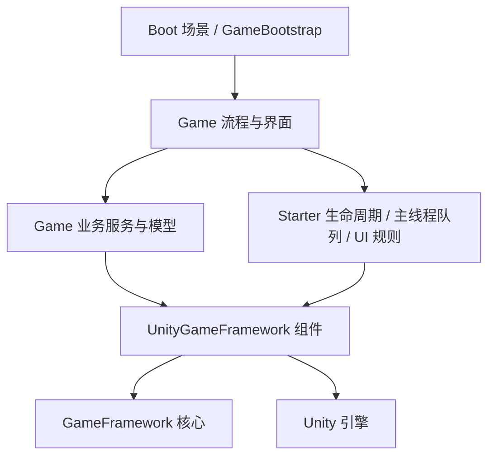

# 架构取舍与开发建议

## 为什么这样拆

原游戏的 GF 资源链路已经带入 Lua、专用加密及平台适配约定。直接搬出会把这些隐含依赖带给新项目。这套工程使用配套的官方 GF 源码，把项目规则放到独立的 Starter 和 Game 程序集中。

`Starter.Core` 不依赖 Unity。`Starter.Runtime` 依赖 GF 和引擎，但不反向引用 Game。`Starter.Game` 承载可替换的业务示例。Editor 工具单独编译，运行包不带编辑器依赖。

## 启动与资源责任

`GameBootstrap` 负责跨场景宿主、主线程回调队列、生命周期取消信号、启动设置引用以及下载确认/错误兜底。GF ProcedureComponent 在所有组件 Start 之后进入 ProcedureBoot，避免入口重复启动流程。

`ProcedureBoot` 获取 GF 组件；Launch 初始化资源模式，CheckVersion / UpdateResource 完成可更新模式的版本与资源准备，Preload 读取示例配置，EnterGame 进入项目业务，ChangeScene 管理业务场景切换。Menu / Play 流程拥有自己打开的界面，离开时关闭已加载窗口，或标记正在加载的窗口结束后回收。详见 `procedures.md`。

加载配置的回调用 generation 与 active 标记判断是否过期，过期结果仍需 UnloadAsset。这个标记只保证迟到结果不再应用业务状态，不会中止已经发生的磁盘或网络 IO。需要真正取消时必须接入底层操作的取消能力。

## 对新项目的具体意见

1. **先把一个业务闭环跑通。** 保留 GF 底座，按需要接入模块，不要先给每个管理器再套一层单例。一个独立服务有真实业务责任时再拆。
2. **GameServices 只做入口装配。** 示例为了易读使用静态入口。项目变大后让金币、背包、任务等服务通过构造函数取得必要接口，避免业务函数到处读取全局状态。
3. **界面负责显示和输入，服务负责规则，模型负责数据。** 不要让 UI 直接决定扣款、库存或订单是否合法。示例 Wallet 的边界检查可作为最小参照。
4. **事件用于状态通知，直接调用用于明确命令。** `Grant` 是命令；`CoinsChanged` 是通知。需要返回值或失败原因时，直接调用服务更清晰，不要用全局事件代替所有函数调用。
5. **池化对象的生命周期必须写清楚。** GF UI 关闭后常驻池中；事件参数派发后回收。OnClose 应解绑订阅，回调里复制所需值，不缓存 args。
6. **优化应基于设备数据。** 单看调用次数，不能判断该删哪个模块、是否该改多线程。先测主线程、GC、资源加载和内存峰值。GF TaskPool 是任务调度队列，不是 .NET 线程池。
7. **表格与多语言按内容规模选。** 小项目 JSON 可以起步；配置量大后再接 DataTable、校验与生成工具。Localization 也应根据语言和发布需求接入，源码暂未使用并不等于应该删除。
8. **发布系统独立设计。** 客户端已经有清单检查、资源分组、确认和有限重试。正式发布仍需版本接口、CDN、空间检查、回滚、包体内置资源策略和平台验收，按 `procedures.md` 接入自己的发布服务。

## 什么时候考虑 Lua / Addressables / UniTask

C# 已经能够开发完整项目。需要脚本热更、已有 Lua 团队或明确的渠道更新约束时，再引入 Lua，并单独封装虚拟机、资源加载和启动流程。不要让 GF 核心直接依赖 Lua 入口。

GF Resource 与 Addressables 都管理资源生命周期。若决定采用 Addressables，应通过项目资源接口替换调用路径，并测试所有权和释放规则；同时让两套系统持有同一资源会增加排查难度。

UniTask 可以改善等待代码的写法，但不会自动把重计算移到后台，也不能替代取消、异常处理、资源释放和平台验证。先确定调用线程与生命周期，再选择语法。

## 当前应知道的边界

- 本地 Setting 是演示级持久化，不提供安全存档、云存档或反作弊。
- 主线程队列限制为最多 1024 个待执行回调，每帧执行最多 64 个；这是数量预算，不是毫秒预算。回调本身仍需短小。
- 暂无登录、支付、广告、WebSocket 协议、背包、战斗、服务器或热更发布系统。
- `link.xml` 为起步保留全部 GF、Starter 运行时程序集，方便反射创建流程和辅助器。正式 IL2CPP 发布应评估包体，收紧到实际反射类型并做设备验收。
- 官方 GF 固定在旧的配套版本。升级时对照 `upstream.json` 和修改清单合入，并复跑核心与场景测试，不要用单个仓库的最新文件直接覆盖。
