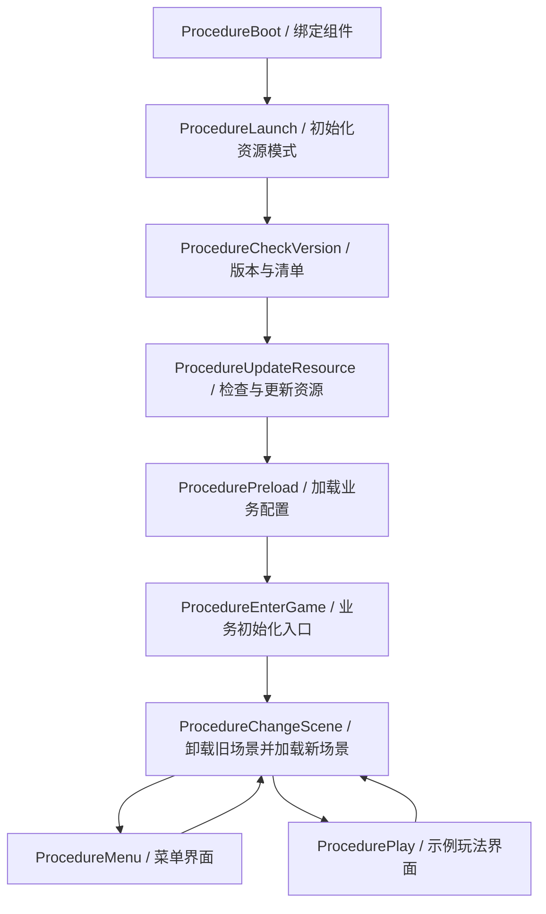

# Procedure 启动链与场景切换

流程脚本在 `Assets/Game/Runtime/Procedures`。原工程可复用的启动职责已迁入，去除了 Lua、平台 SDK 和游戏服务器依赖。



## 各流程改哪里

| 流程 | 现有职责 | 新项目常见改法 |
|---|---|---|
| ProcedureBoot | 绑定 Base、Event、Resource、Setting、UI、Scene、Sound、Entity | 装配自己的项目服务，保留单一入口 |
| ProcedureLaunch | 校验设置；Package 初始化一次；Editor/可更新模式选择分支 | 加 SDK 初始化或平台能力校验；异步完成后再切下一步 |
| ProcedureCheckVersion | 可更新模式请求 JSON；检查/下载 GF 版本清单 | 接自己的版本接口，增加客户端版本、维护公告等业务策略 |
| ProcedureUpdateResource | 检查本地资源，下载确认、按组更新、进度与失败处理 | 更换加载界面，配置启动必需分组 |
| ProcedurePreload | 通过 GF 读取并释放 GameConfig TextAsset，组装 GameSession | 增加项目配置、多语言、公共资源预加载 |
| ProcedureEnterGame | 业务初始化完成后请求菜单场景 | 接存档迁移、登录、选服或可选 Lua 初始化 |
| ProcedureChangeScene | 清声音/实体，等旧业务场景卸载，再加载目标场景 | 扩展 SceneDestination 与目标业务流程；选择是否保留跨场景音乐/实体 |
| ProcedureMenu / ProcedurePlay | 拥有各自 UI；请求下一场景 | 替换为自己的大厅、战斗、关卡等流程 |

公共 ProcedureBase 提供每次进入的代号和活动检查，防止迟到回调把状态写进下一次进入。`UseNativeDialog` 默认 true，UiProcedure 为 false，作为项目层区分资源就绪前后提示方式的约定；它不会抛出原实现中的 NotImplementedException。启动状态、下载确认与错误兜底目前由 GameBootstrap 的原生 IMGUI 面板显示。

## 默认运行与启动设置

设置资产：`Assets/Game/Settings/StartupSettings.asset`，由 Boot / GameBootstrap 直接引用，不依赖尚未初始化的 GF 资源系统。

- **Editor Resource Mode**：直接从编辑器资源加载，跳过远端版本/更新。
- **Package**：Launch 调用一次 InitResources，后续只使用随包资源；默认 Player 构建使用此模式。
- **Updatable / UpdatableWhilePlaying**：CheckVersion 请求已配置端点，更新 GF 清单；UpdateResource 检查并更新启动所需资源。没有配置端点时直接显示具体错误。

| 设置 | 默认 | 含义 |
|---|---|---|
| VersionManifestUrl | 空 | 仅可更新模式需要，填写自己提供的 HTTP(S) JSON URL |
| VersionRequestTimeoutSeconds | 15 | 每次版本 HTTP 请求的超时 |
| VersionRequestAttempts | 3 | 总尝试次数，失败之间按 1 秒、2 秒递增等待 |
| ResourceUpdateRetryCount | 2 | GF 每个资源失败后的重试次数，即最多 3 次尝试 |
| OperationTimeoutSeconds | 120 | 初始化、版本检查、预加载、切场景的最长等待；资源更新阶段为无进度超时 |
| RequireDownloadConfirmation | true | 存在需下载资源时，先等用户确认 |
| RequiredResourceGroups | 空数组 | 空数组下载全部；非空则按顺序下载这些 GF 资源组 |

启动组必须包含业务预加载与首场景所需资源。重复组名只更新一次；空白组名与不存在的组会报错。多个组共用的资源通过 GF ResourceGroupCollection 去重统计。UpdatableWhilePlaying 后续可按需更新其他组；普通 Updatable 若只下载启动组，其余内容必须在业务加载前显式完成更新。

自定义加载 UI 可读取 `GameBootstrap.Status`、`DownloadedBytes`、`TotalDownloadBytes`、`Failure`、`DownloadConfirmationPending`，在主线程调用 `ConfirmResourceDownload()`。默认面板已接好确认按钮。进度以压缩字节计，包含已校验完成资源和当前下载字节；重试时进度允许回退，不会把失败尝试重复累计。确认等待不计入无进度超时。

## 版本接口与发布资源

JSON 字段如下，数值只是结构示例，不能拿示例 CRC 充当真实构建数据：

```json
{
  "internalResourceVersion": 7,
  "updatePrefixUri": "https://cdn.example.com/my-game/0_1_0_7/Windows64",
  "versionListLength": 1024,
  "versionListHashCode": -123456789,
  "versionListCompressedLength": 512,
  "versionListCompressedHashCode": 123456789
}
```

用工程自带 GF Resource Builder 构建 **Full** 资源，选择正确平台、递增 Internal Resource Version，并使用与运行时相同的 DefaultCompressionHelper。构建输出必须设到 `E:\AI\_DownLoads\unity-gf-starter` 下的新目录。官方构建器可能清理它的输出目录，不要让它指向已有业务文件夹。

构建日志 `Process updatable version list ...` 会输出清单的原始长度、原始 CRC、压缩长度、压缩 CRC；也可实现官方 `IBuildEventHandler.OnOutputUpdatableVersionListData` 接入自己的发布工具。将这四个值和对应 Internal Resource Version 填入版本 JSON。GF CRC 字段为有符号 int，负数有效。

将 **Full 对应平台目录的完整内容**部署到 updatePrefixUri：保留 GF 生成的带 hash 文件名与目录层级，不要只上传 Package 文件，也不要重命名压缩资源。updatePrefixUri 为目录 URL，不带 query/fragment；版本接口 URL 可单独指向业务接口。不同平台使用各自对应的版本接口与资源。

在 Boot 的 ResourceComponent 选择 Updatable 或 UpdatableWhilePlaying，取消 Base 的 Editor Resource Mode 才能在编辑器实际走远端分支。在 StartupSettings 填写自己的端点。只切 ResourceMode 且仍启用 Editor Resource Mode，会继续走编辑器直读分支。

`Starter/3` 和 `Starter/4` 继续构建离线 Package。它们没有变成 CDN 发布入口；本次提供的是客户端流程，不包含版本服务器、自动发布、磁盘空间检查、签名验真、维护公告、整包升级、回滚或离线降级策略。资源更新也不会让 C# 业务代码自动热更。

## 失败与重试

版本 HTTP 请求有有限重试。JSON 格式/字段、GF 清单校验、资源组最终失败、配置加载或场景失败均阻止进入后续业务，并通过无资源依赖的面板显示错误。GF 版本清单请求不另外叠加一层并发重试；GF 资源下载由它自己的每资源重试机制处理。

失败面板提示检查配置/网络后重启。已完成的资源由 GF 缓存并在下次检查时识别，不会一律重新下载。工程没有给出“本次失败后直接从中间流程重入”的按钮，避免重复初始化官方 GF 检查器。跨进程断点续传、损坏恢复及平台存储策略需要真实服务与设备验证。

## 场景所有权

Boot 通过 Unity 正常加载，包含常驻 GameRoot、主相机和 EventSystem。Menu.unity / Play.unity 是两个最小业务场景，可直接替换环境内容；它们通过 GF Scene 加载，分别打入 `demo/scenes/menu`、`demo/scenes/play`。

切换时，UiProcedure 先关闭自己拥有的 UI，包括仍在加载中的 UI。ChangeScene 停止加载中和已播放的声音、隐藏加载中和已显示的实体，等待 GF 管理的旧业务场景卸载，再加载目标场景；成功事件使用本次独立 token 判断归属，随后在 OnUpdate 进入目标流程。Boot 不在 GF 管理列表中，不会被这一步卸载。

如果你的项目需要常驻音乐、跨场景角色或叠加场景，修改 ProcedureBase.ClearTransientObjects 和 ChangeScene 的卸载筛选。不要让多个系统同时管理同一场景请求。当前模板要求切换开始时没有其他 GF 场景操作；超时/失败会停住，已发起的引擎 IO 不会因注销事件而被物理撤销。

新增业务场景时，维护 AssetNames、GF ResourceCollection、SceneDestination 和 ChangeScene 的目标流程分支。Editor Resource Mode 加载的场景还要加入 EditorBuildSettings；正式 Player 中通过 AssetBundle 加载的业务场景不再放入 BuildPlayerOptions.scenes，避免同一场景既入内置包又入资源包。

## Boot 接线与迁移工具

本工程已注册全部 9 个具体 Procedure，入口为 ProcedureBoot。新建脚本不会自动注册流程。

`Starter/7. Configure Procedure Flow` 可把早期底座升级到这条链：追加缺少的流程类型、补设置引用、创建不存在的两个场景、补资源映射。它保留现有流程与场景对象，不重新生成 UI。已有自定义入口会保留，但示例验证器要求入口仍为 ProcedureBoot，会明确报错，需按自己的最终业务调整校验规则。

反射创建的流程仍由现有 link.xml 保留。Lua 可在 Launch 初始化虚拟机，在资源更新后 Preload/EnterGame 加载与执行；原工程 ProcedureLoadLuaScripts / ProcedureExecLuaScripts 中没有可复用的完成链路，因此不复制空类。
